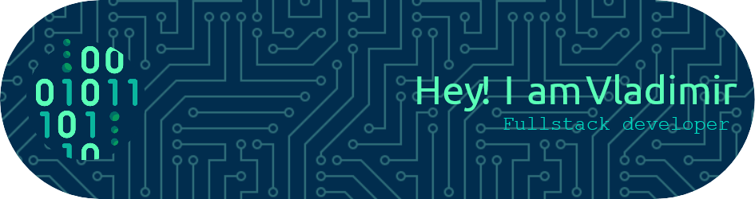
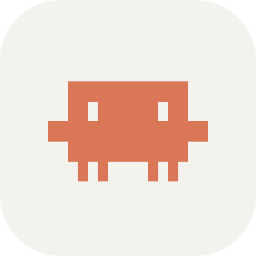
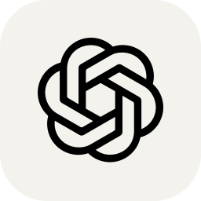
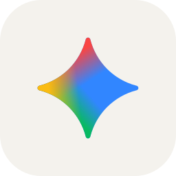
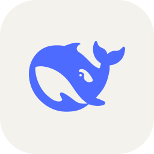
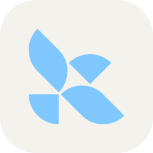
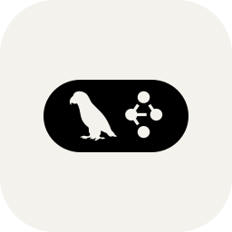

<!-- Header -->

## About

Hi, I'm **Vladimir (Kosmo) Otero Mariño**, a **Senior AI Agent Developer** and founder of **Fragua Tech**, based in Bilbao (Basque Country, Spain).

I build **AI agents and automations that work in production**, not just in demos: multi-step agents with LangChain and LangGraph, RAG pipelines that ground answers in real data, MCP servers that connect models to real tools and data, and workflows on top of Claude, OpenAI, Gemini and DeepSeek. Under the hood I'm a full-stack TypeScript developer (React, Node.js, Express, PostgreSQL, Docker), which is what lets those agents ship as real products.

I hold a degree in Informatics Engineering (2024) and I'm a two-time **ICPC World Finalist**, so I care a lot about algorithms, performance and getting things right.

### Tech stack

<!-- Technologies -->
<table>
<tr>
<td><b>AI &amp; Agents</b></td>
<td>
<picture><source media="(prefers-color-scheme: dark)" srcset="./assets/icons/ClaudeCode-Dark.svg"><source media="(prefers-color-scheme: light)" srcset="./assets/icons/ClaudeCode-Light.svg"></picture>
<picture><source media="(prefers-color-scheme: dark)" srcset="./assets/icons/OpenAI-Dark.svg"><source media="(prefers-color-scheme: light)" srcset="./assets/icons/OpenAI-Light.svg"></picture>
<picture><source media="(prefers-color-scheme: dark)" srcset="./assets/icons/Gemini-Dark.svg"><source media="(prefers-color-scheme: light)" srcset="./assets/icons/Gemini-Light.svg"></picture>
<picture><source media="(prefers-color-scheme: dark)" srcset="./assets/icons/DeepSeek-Dark.svg"><source media="(prefers-color-scheme: light)" srcset="./assets/icons/DeepSeek-Light.svg"></picture>
<picture><source media="(prefers-color-scheme: dark)" srcset="./assets/icons/LangChain-Dark.svg"><source media="(prefers-color-scheme: light)" srcset="./assets/icons/LangChain-Light.svg"></picture>
<picture><source media="(prefers-color-scheme: dark)" srcset="./assets/icons/LangGraph-Dark.svg"><source media="(prefers-color-scheme: light)" srcset="./assets/icons/LangGraph-Light.svg"></picture>
<picture><source media="(prefers-color-scheme: dark)" srcset="./assets/icons/RAG-Dark.svg"><source media="(prefers-color-scheme: light)" srcset="./assets/icons/RAG-Light.svg"></picture>
<picture><source media="(prefers-color-scheme: dark)" srcset="./assets/icons/MCP-Dark.svg"><source media="(prefers-color-scheme: light)" srcset="./assets/icons/MCP-Light.svg"></picture>
</td>
</tr>
<tr>
<td><b>Languages</b></td>
<td>

<picture><source media="(prefers-color-scheme: dark)" srcset="https://github.com/tandpfun/skill-icons/raw/main/icons/Python-Dark.svg"><source media="(prefers-color-scheme: light)" srcset="https://github.com/tandpfun/skill-icons/raw/main/icons/Python-Light.svg"></picture>

</td>
</tr>
<tr>
<td><b>Frontend</b></td>
<td>
<picture><source media="(prefers-color-scheme: dark)" srcset="https://github.com/tandpfun/skill-icons/raw/main/icons/React-Dark.svg"><source media="(prefers-color-scheme: light)" srcset="https://github.com/tandpfun/skill-icons/raw/main/icons/React-Light.svg"></picture>
<picture><source media="(prefers-color-scheme: dark)" srcset="https://github.com/tandpfun/skill-icons/raw/main/icons/NextJS-Dark.svg"><source media="(prefers-color-scheme: light)" srcset="https://github.com/tandpfun/skill-icons/raw/main/icons/NextJS-Light.svg"></picture>

<picture><source media="(prefers-color-scheme: dark)" srcset="https://github.com/tandpfun/skill-icons/raw/main/icons/Vite-Dark.svg"><source media="(prefers-color-scheme: light)" srcset="https://github.com/tandpfun/skill-icons/raw/main/icons/Vite-Light.svg"></picture>
<picture><source media="(prefers-color-scheme: dark)" srcset="https://github.com/tandpfun/skill-icons/raw/main/icons/TailwindCSS-Dark.svg"><source media="(prefers-color-scheme: light)" srcset="https://github.com/tandpfun/skill-icons/raw/main/icons/TailwindCSS-Light.svg"></picture>

</td>
</tr>
<tr>
<td><b>Backend</b></td>
<td>
<picture><source media="(prefers-color-scheme: dark)" srcset="https://github.com/tandpfun/skill-icons/raw/main/icons/NodeJS-Dark.svg"><source media="(prefers-color-scheme: light)" srcset="https://github.com/tandpfun/skill-icons/raw/main/icons/NodeJS-Light.svg"></picture>
<picture><source media="(prefers-color-scheme: dark)" srcset="https://github.com/tandpfun/skill-icons/raw/main/icons/ExpressJS-Dark.svg"><source media="(prefers-color-scheme: light)" srcset="https://github.com/tandpfun/skill-icons/raw/main/icons/ExpressJS-Light.svg"></picture>

<picture><source media="(prefers-color-scheme: dark)" srcset="https://github.com/tandpfun/skill-icons/raw/main/icons/Sequelize-Dark.svg"><source media="(prefers-color-scheme: light)" srcset="https://github.com/tandpfun/skill-icons/raw/main/icons/Sequelize-Light.svg"></picture>
</td>
</tr>
<tr>
<td><b>Databases</b></td>
<td>
<picture><source media="(prefers-color-scheme: dark)" srcset="https://github.com/tandpfun/skill-icons/raw/main/icons/PostgreSQL-Dark.svg"><source media="(prefers-color-scheme: light)" srcset="https://github.com/tandpfun/skill-icons/raw/main/icons/PostgreSQL-Light.svg"></picture>
<picture><source media="(prefers-color-scheme: dark)" srcset="https://github.com/tandpfun/skill-icons/raw/main/icons/MySQL-Dark.svg"><source media="(prefers-color-scheme: light)" srcset="https://github.com/tandpfun/skill-icons/raw/main/icons/MySQL-Light.svg"></picture>

<picture><source media="(prefers-color-scheme: dark)" srcset="https://github.com/tandpfun/skill-icons/raw/main/icons/Redis-Dark.svg"><source media="(prefers-color-scheme: light)" srcset="https://github.com/tandpfun/skill-icons/raw/main/icons/Redis-Light.svg"></picture>
</td>
</tr>
<tr>
<td><b>Desktop &amp; Mobile</b></td>
<td>

<picture><source media="(prefers-color-scheme: dark)" srcset="https://github.com/tandpfun/skill-icons/raw/main/icons/Tauri-Dark.svg"><source media="(prefers-color-scheme: light)" srcset="https://github.com/tandpfun/skill-icons/raw/main/icons/Tauri-Light.svg"></picture>
</td>
</tr>
<tr>
<td><b>Testing</b></td>
<td>

<picture><source media="(prefers-color-scheme: dark)" srcset="https://github.com/tandpfun/skill-icons/raw/main/icons/Vitest-Dark.svg"><source media="(prefers-color-scheme: light)" srcset="https://github.com/tandpfun/skill-icons/raw/main/icons/Vitest-Light.svg"></picture>
</td>
</tr>
<tr>
<td><b>DevOps &amp; Tools</b></td>
<td>

<picture><source media="(prefers-color-scheme: dark)" srcset="https://github.com/tandpfun/skill-icons/raw/main/icons/GithubActions-Dark.svg"><source media="(prefers-color-scheme: light)" srcset="https://github.com/tandpfun/skill-icons/raw/main/icons/GithubActions-Light.svg"></picture>

<picture><source media="(prefers-color-scheme: dark)" srcset="https://github.com/tandpfun/skill-icons/raw/main/icons/Github-Dark.svg"><source media="(prefers-color-scheme: light)" srcset="https://github.com/tandpfun/skill-icons/raw/main/icons/Github-Light.svg"></picture>
<picture><source media="(prefers-color-scheme: dark)" srcset="https://github.com/tandpfun/skill-icons/raw/main/icons/Linux-Dark.svg"><source media="(prefers-color-scheme: light)" srcset="https://github.com/tandpfun/skill-icons/raw/main/icons/Linux-Light.svg"></picture>
<picture><source media="(prefers-color-scheme: dark)" srcset="https://github.com/tandpfun/skill-icons/raw/main/icons/VSCode-Dark.svg"><source media="(prefers-color-scheme: light)" srcset="https://github.com/tandpfun/skill-icons/raw/main/icons/VSCode-Light.svg"></picture>

</td>
</tr>
</table>

## Goals

There's still a huge amount of impactful software to build, and AI agents are changing how it gets built. With Fragua Tech I help companies bring agents and automation into their day-to-day work in a way that is reliable and measurable. Alongside that, I want to keep contributing to open source, giving back to the community that has given me so much.

So let's give the snake a lot of contributions to eat :)

<picture>
    <source media="(prefers-color-scheme: dark)" srcset="https://raw.githubusercontent.com/kosmo00/kosmo00/output/github-contribution-grid-snake-dark.svg">
    <source media="(prefers-color-scheme: light)" srcset="https://raw.githubusercontent.com/kosmo00/kosmo00/output/github-contribution-grid-snake.svg">
    
</picture>

## Portfolio

Coming soon...

## Contact me

Want to talk about AI agents or automation? Reach out on [LinkedIn](https://www.linkedin.com/in/vladimir-otero-mari%C3%B1o/). I'll reply as soon as possible!
